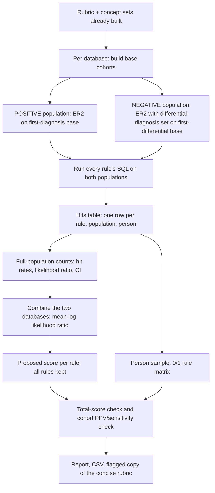

# Rubric Improvement Process: Technical Description

**Audience:** epidemiologists, biostatisticians and bioinformaticians who have not used this system.
**Scope:** the data-driven rule scoring in the package (`applyDataDrivenRuleScores()` and `applyDataDrivenRuleScoresFromConfig()`, code in `R/ithacaDataDrivenEvidence.R` and `R/ithacaDataDrivenScores.R`) and the probe wrapper `probeRubricImprovement()` in `extras/rubricImprovementProbe.R`, which runs the same analysis without applying anything. It does not describe how rubrics are first generated by the language model, how concept sets are built, or how the final rubric is used to score a population, except where needed to follow the method.

**Status:** the statistical and decision code, the gate and the rubric edit are covered by unit tests on simulated data. The SQL collection stage runs against Databricks (the two-database report has been produced for several conditions); applying scores to a rubric has not yet been run against live results. The gate limits and `capLr` are defaults rather than tested results.

---

## 1. Purpose in one paragraph

A *rubric* is a points-based computable phenotype: a list of rules, each worth a number of points when satisfied in a person's record, summed into a total that classifies the person as having the condition (YES), not having it (NO), or indeterminate. A language model drafts the rules and their points. Those points are educated guesses. The improvement process uses observational data in two databases to test every rule: does it actually separate people who have the condition from people who do not, and what weight do the data give it? Each rule's proposed score comes from its likelihood ratio; every rule is kept. The output is a set of *recommendations*, with the evidence behind each. `applyDataDrivenRuleScores()` applies them to the concise rubric when a gate passes (Section 6.11); `probeRubricImprovement()` only reports.

---

## 2. Background: the system in brief

### 2.1 Data model

All analysis runs on databases in the **OMOP Common Data Model (CDM)**. The tables used are `person`, `observation_period`, `visit_occurrence`, `condition_occurrence`, `drug_exposure`, `procedure_occurrence`, `measurement`, `observation`, and `concept`. Two databases are used by default:

| Database | CDM schema (as configured) | Typical content |
|---|---|---|
| OptumDod | `cdm_optum_extended_dod_v4155` | US administrative claims |
| Ccae | `cdm_merative_ccae_v4149` | US commercial claims |

Both are hosted in Databricks (Spark SQL). SQL in the rubric is written in OHDSI SQL (SQL Server flavor) and translated to Spark with SqlRender.

### 2.2 The rubric

A condition has one or more *rubrics* (usually one, `R1`). Each rubric has:

* **Rules**, each with an ID, a type, a score, a plain-language criterion, a list of *concept sets* it needs, and an SQL statement implementing it.
* **Rule types**
  * `ER#` evidence rules (`evidenceRules`): add points when satisfied.
  * `AE#` alternative explanations (`alternativeExplanations`): subtract points when satisfied (the person has another explanation for the findings).
  * `HE#` hard exclusions (`hard_exclusion`): force a negative decision (score −100).
* **Thresholds:** a total at or above `rubricYesScore` (fixed at 10) is YES; below `rubricNoScore` is NO.
* **Fixed rules** that are written by the software rather than the language model:
  * `ER1` and `ER2`: the condition's diagnostic criteria expressed as claims patterns (for example "one inpatient or ED diagnosis code, or two outpatient codes 1 to 60 days apart"). ER1 is worth 3 points; ER2 is worth 2 plus a configured number of additional points (0 to 4).
  * `AE1`: a "zero occurrence" penalty (default −3) for people with no code for the condition or for related diagnoses within ±30 days of the index date.

### 2.3 Index date and rule windows

Every rule is evaluated *relative to a person's index date*. Windows are written as day offsets (for example "within −60 to +180 days of index"). The index date is supplied by whatever base cohort the rule SQL is run against. This is why this process constructs its own base cohorts (Section 5): the choice of index date defines what "before" and "after" mean for every rule.

### 2.4 Concept sets

Rule SQL does not contain concept IDs. It contains placeholders such as `@asthma_DIAGNOSIS_CODES` that are replaced at run time with a list of concept IDs (including descendants) stored in a *concept set library* and *matched* to the condition. Two concept sets are special in this process:

* `<condition>_DIAGNOSIS_CODES`: diagnosis concepts for the condition itself.
* `<condition>_RELEVANT_DIAGNOSIS_CODES`: diagnosis concepts for related or *differential* diagnoses; by construction it excludes the condition itself. It is used by `AE1`.

If a placeholder cannot be resolved, the software substitutes a dummy concept ID and records the failure. The process reports such rules instead of judging them (Section 6.7).

---

## 3. The problem being solved

The language model chooses rules and points from clinical knowledge, not from the data. That creates specific, testable weaknesses:

1. **Rules that never fire** (concept set empty or wrong, window too narrow, data type absent from claims). They add nothing and clutter the rubric.
2. **Rules with the wrong direction.** A rule labeled as an exclusion that is in fact more common in confirmed cases, or the reverse.
3. **Poorly weighted rules.** A rule worth 5 points that is barely more common in cases than non-cases.
4. **Correlated rules that double-count.** In a condition such as autism, speech therapy, occupational therapy and applied behavior analysis occur together. Summing separate points for each overstates the evidence. This process does not adjust for it: each rule is scored on its own.
5. **No replication.** A rule that works in one database may reflect that database's coding practices.

The process measures items 1, 2, 3 and 5 and turns the measurements into proposed scores.

**What the process cannot do** is establish truth. It has no clinical reference standard; it compares rule behavior in two *constructed* populations (Section 5). Section 11 lists the consequences.

---

## 4. Process overview



The two databases are processed one after the other; within a database the SQL statements run in parallel on several worker processes (Section 6.10).

---

## 5. Constructing the populations

Everything downstream depends on these definitions, so they are stated precisely.

### 5.1 Why constructed populations

To measure whether a rule separates cases from non-cases, one needs a set of probable cases and a set of probable non-cases, each with an index date. No gold-standard labels exist for the whole database, so the process builds both sets from claims codes and applies the *same* procedure to each so that their structure is comparable.

### 5.2 Base cohorts (the index dates)

All steps use `condition_occurrence`.

* **Candidate positives (base cohort 90).** For every person with at least one record whose `condition_concept_id` is in `<condition>_DIAGNOSIS_CODES`: the person's **earliest** `condition_start_date` among those records is the index date.
* **Candidate negatives (base cohort 91).** For every person with at least one record in `<condition>_RELEVANT_DIAGNOSIS_CODES`: the person's **earliest** such date is the index date, **excluding** anyone who has *any* record in `<condition>_DIAGNOSIS_CODES` at any time.

The "never has the condition's own code" exclusion is an explicit modeling choice, so that negatives are people who were never coded with the condition. It makes the negatives cleaner and the comparison harder to pass for rules that mark the condition.

### 5.3 The ER2 filter applied to each base cohort

The definitive-evidence rule ER2 is a claims pattern (settings, counts, and day windows relative to index). It is applied to each base cohort using its own SQL:

* **POSITIVE population:** ER2's SQL run unchanged against base cohort 90. The people the SQL returns are the positives. In words: *people whose first diagnosis of the condition is accompanied by the definitive diagnostic pattern.*
* **NEGATIVE population:** ER2's SQL run against base cohort 91 **after replacing the placeholder `@<condition>_DIAGNOSIS_CODES` with `@<condition>_RELEVANT_DIAGNOSIS_CODES`**. The people returned are the negatives. In words: *people whose first differential diagnosis shows the same claims pattern (for example one inpatient code, or two outpatient codes a month apart) as a definitive diagnosis would.*

The purpose of the swap is to equalize the **intensity of health-care contact** between groups. If positives had to show the diagnostic pattern and negatives did not, any rule that tracks health-care use (visits, therapies, medications) would appear to discriminate for reasons unrelated to the condition. Matching the pattern removes the largest part of that effect.

ER2 can differ between rubrics, so a positive and a negative population is built for each rubric.

### 5.4 Storage

Populations are written to a temporary Delta table in the scratch schema named in the configuration (`cohortDatabaseSchema`). Columns: `cohort_definition_id` (identifies base cohort, rubric and class), `subject_id`, `cohort_start_date`, `cohort_end_date`. The table, and the hits table below, are dropped at the end of the run.

### 5.5 Known characteristics of these populations

* Positives are people who meet ER2 *around their first diagnosis*. A person whose first code is a single outpatient code with confirmation months later fails ER2 at that index. They are not positives; they fall in the failed-ER2 population used in Section 6.9.
* Negatives are people with a differential diagnosis. They are harder to discriminate from cases than a random sample of the population would be.
* A rule that is part of the ER2 pattern, or tends to occur around the first diagnosis, can look better than it is (circularity).

---

## 6. Methods, step by step

### 6.1 Selecting rules

All rules in the latest short rubric are tested **except** those in `excludeRuleIds`, which defaults to `ER1`, `ER2`, `AE1`. ER2 defines the positives and ER1/AE1 are fixed by the software, so testing them would be circular or pointless. Each tested rule gets an integer index used internally.

### 6.2 Running each rule

The rule's SQL is rendered with the CDM schema, the cohort table and the cohort ID of the population, its concept-set placeholders are resolved, and it is translated to Spark SQL. Run against a base cohort, it returns the subjects who meet the rule. The distinct subjects are written to the hits table as `(rule_idx, cohort_definition_id, subject_id)`.

Every rule is run once per rubric on the union of the POSITIVE, NEGATIVE and failed-ER2 populations (Section 6.9); the three never share a person, so each hit is mapped back to its population by person.

### 6.3 Per-rule hit rates and likelihood ratio

From the full populations (not a sample), for each rule:

* hits among positives `a` of `N₊` persons and among negatives `b` of `N₋` persons;
* proportions `p₊ = a / N₊` and `p₋ = b / N₋`;
* **likelihood ratio** `LR = p₊ / p₋`.

LR is the natural measure here. It is the factor by which meeting the rule multiplies the odds of being in the positive group rather than the negative group, and it does not depend on how many people are in each population (which here are arbitrary). It is **not** a predictive value; the positive and negative populations are not at natural prevalence.

**Confidence interval.** The standard error of `ln(LR)` is

`se = sqrt(1/a − 1/N₊ + 1/b − 1/N₋)`

and the 95% interval is `exp(ln(LR) ± 1.96·se)` (the Katz log method). If `a` or `b` is zero, 0.5 is used in its place (a continuity correction) so the ratio and interval exist. If both are zero the rule is reported as **no hits** and no ratio is computed.

**Verdict.** Each rule has an *expected direction* from its current labeling:

* expected LR > 1 for evidence rules (positive score);
* expected LR < 1 for alternative explanations and hard exclusions (negative score or those types).

The verdict is `supports` if the interval excludes 1 on the expected side, `refutes` if it excludes 1 on the opposite side, and `inconclusive` if the interval contains 1.

### 6.4 Replication across the two databases

A rule's direction is **replicated** only if, in every database with a result, the interval excludes 1 and lies on the same side. If the databases disagree, or one is inconclusive, the effect is **not replicated**. With a single database, replication is trivially satisfied, and the report says which databases were used.

### 6.5 Person sample for the total-score and PPV checks

The full populations can contain millions of people, so person-level totals are computed on a sample:

* the target per population is `matrixPersons / 2` (default 100,000);
* sampling is deterministic: keep persons whose `subject_id` is a multiple of a step, with separate steps for positives, negatives and failed-ER2 people (`step = ceiling(largest population of that kind / (matrixPersons / 2))`).

Rates and likelihood ratios use the full populations; the total-score and PPV/sensitivity checks use the sample.

### 6.6 Proposed score

Each rule's proposed score is its likelihood ratio on the rubric's points scale:

`points = round( scaleMax · mean ln(LR) / ln(capLr) )`, clipped to `[−scaleMax, +scaleMax]`

where the mean is over the databases with a result. Defaults are `scaleMax = 6` and `capLr = 10`: a likelihood ratio of 10 earns 6 points, a ratio of 1 earns 0, and a ratio below 1 gives a negative score. Points are whole numbers. Rules are scored independently; overlap between rules is not adjusted for.

### 6.7 Recommendation rules

Every rule is kept. Each tested rule receives one recommendation, from the first condition that applies:

| Order | Condition | Proposed score | Recommendation |
|---|---|---|---|
| 1 | A query for the rule failed in any database | current | `REVIEW` (flag review) |
| 2 | A concept set for the rule did not resolve | current | `REVIEW` (flag review) |
| 3 | Hard exclusion | current | `KEEP` |
| 4 | No hits in either population in any database | current | `KEEP` |
| 5 | Otherwise | from the likelihood ratio (Section 6.6) | `KEEP` if unchanged; `RESCALE` if the score changes; `CHANGE_TYPE` (flag review) if the sign is opposite to the rule's type |

With `CHANGE_TYPE`, a positive score proposes `evidenceRules` and a negative score proposes `alternativeExplanations`. A score of 0 keeps the type and the rule. The reason notes when the direction differs between databases.

### 6.8 Total-score check and scale calibration

The per-rule results are not enough to know how the rubric will behave, because classification uses sums. For each sampled person the total of the tested rules' scores is computed:

* **Before:** with current scores.
* **After:** with proposed scores.

To approximate production, **positives start with ER2's own points** (every positive meets ER2 by construction) and negatives start with 0. ER1 and AE1 are not added; the report states this. Reported for each database and rubric: the share of positives and of negatives with total ≥ `rubricYesScore`.

**Scale calibration.** The proposed scores can be systematically smaller than the originals (the scale caps a high-LR rule at `scaleMax`). If the share of positives reaching YES with proposed scores falls below 80% of the current share, the report finds the smallest multiplier `k` from 1.0 to 6.0 in steps of 0.1 such that scaling the proposed scores by `k` restores the positives' YES share, and reports the resulting shares of positives and negatives at YES. This is a recommendation about the scale, not a change to the rubric.

### 6.9 Cohort PPV/sensitivity check

Treats ER2 as the cohort definition and the rubric as the judge. A third population is built per rubric: people with the condition's diagnosis (the candidate base cohort) who fail ER2, indexed at their first diagnosis. Every tested rule, and ER1, is run on it.

* **PPV** = cohort members reaching YES / all cohort members.
* **Sensitivity** = cohort members reaching YES / (cohort members reaching YES + people outside the cohort reaching YES), where outside = differential negatives + failed-ER2 people.

AE1 is always 0. Cohort members get ER1 + ER2 points, failed-ER2 people get ER1 if they meet it, and differential negatives get neither; the YES threshold is unchanged.

For current and proposed scores, the report gives per database the PPV, sensitivity and the misses from each outside group, with ER1 at its rubric value and raised by 2 and by 4 points. Counts come from the person sample and are not weighted to database size.

### 6.10 Computation and parallelism

* One Databricks connection is held in the main session; worker processes (default from the configuration's `general.parallelWorkers.scoring`) each open their own connection per database.
* Independent statements run concurrently: the two base cohort inserts; the ER2 population inserts for all rubrics; the per-rule hit inserts (one per rule, run on the union of the positive, negative and failed-ER2 populations, which never share a person, with hits mapped back to each population by person; plus ER1 on the failed-ER2 population).
* Concurrent inserts into the same Delta table are safe because each writes different cohort IDs and the writes are appends.
* Databases are processed sequentially; the worker cluster is reused. Temporary tables are dropped when the run ends or fails.
* A rule SQL statement that fails to render or run is recorded per rule and reported; it does not stop the run.

### 6.11 Applying the scores and the gate

`applyDataDrivenRuleScores()` writes the proposed scores into the concise rubric only if a gate passes.

**Gate.** For each database and rubric, the sampled cohort members (ER2 positives, who get ER1 + ER2 points) and differential negatives (who get neither) are totalled with the proposed scores, with AE1 = 0, and the shares reaching YES (10) are compared with limits. Every database and rubric must satisfy all limits:

| Limit | Default | Guards against |
|---|---|---|
| `positiveYesMax` (cohort YES share at most) | 0.95 | Saturation: nearly everyone reaches YES, for example when correlated rules add up |
| `positiveYesMin` (cohort YES share at least) | 0.50 | Collapse: the scores are too small to reach YES |
| `negativeYesMax` (differential-negative YES share at most) | 0.10 | Over-calling people without the condition |
| `separationMin` (cohort share minus negative share at least) | 0.30 | A rubric that no longer discriminates |

These values are provisional and should be tuned from report-only runs (`applyChanges = FALSE`). If any limit fails, nothing is changed for that condition; the status is `gateFailed` and the reason names the database, rubric and limit.

**What is written.** Rules whose score changed are written with their new scores; a rule whose score changes sign gets the matching type (a positive score is an evidence rule, a negative score an alternative explanation) and a new rule ID, and keeps its SQL (the SQL does not depend on the type). Hard exclusions, rules with 0 records in both populations, rules whose query failed and rules with an unresolved concept set keep their current score; the report lists them. ER1, ER2 and AE1 are never changed, and the YES and NO thresholds are not written. The change is applied as an ordinary concise rubric edit, so new rubric versions and a rubric delta are saved.

**Preconditions.** The latest concise rubric must have no unapplied edits, and the concept sets must be matched.

---

## 7. Outputs

With `saveResults = TRUE` (default), under `<outputDirectory>/rubricEvidenceProbe/`:

| File | Contents |
|---|---|
| `<condition>_improvementReport_<time>.txt` | The narrative report described below. |
| `<condition>_improvementRules_<time>.csv` | One row per rule: current type and score, recommendation, flag, proposed type and score, the likelihood-ratio score (`lrScore`), reason, per-database evidence string. |
| `<condition>_conciseRubricFlagged_<time>.csv` | Copy of the latest concise rubric with added columns `probeFlag`, `probeReason`, `probeProposedType`, `probeProposedScore`. |
| `queryResults/<condition>_queryResults_<database>_<time>.rds` | Always saved: the query results for one database (population sizes, hit counts, the person sample and its hits), with a fingerprint of the rules, rule SQL, CDM schema, `personModulus` and `matrixPersons`. With `reuseQueryResults = TRUE` the latest matching file is used instead of running the SQL. |

The returned R object contains the same table plus the per-database analysis.

**Report sections:** header and population sizes per database; summary counts per recommendation; recommendation table; per-database evidence (likelihood ratio, interval, verdict); total-score check with calibration; cohort PPV/sensitivity check; notes on assumptions.

**Nothing is applied by the probe.** The flagged copy is advisory. `applyDataDrivenRuleScores()` writes the scores only when the gate passes (Section 6.11).

---

## 8. Parameters

| Parameter | Default | Meaning |
|---|---|---|
| `databaseIds` | config `dataDrivenScoring.databaseIds`, else `general.cdm` | Databases analyzed (the probe wrapper defaults to `OptumDod`, `Ccae`) |
| `excludeRuleIds` | `ER1`, `ER2`, `AE1` | Rules not tested |
| `personModulus` | 1 | Keep persons with `person_id` divisible by this (1 = all); a quick test uses e.g. 97 |
| `workers` | config value | Parallel worker processes for SQL |
| `matrixPersons` | 200,000 | Approximate persons in the person-level sample |
| `scaleMax`, `capLr` | 6, 10 | Likelihood ratio `capLr` earns `scaleMax` points |
| `yesScore`, `noScore` | 10, 2 | Thresholds used by the gate (not written to the rubric) |
| `gate` | see Section 6.11 | Limits that must hold for the scores to be applied |
| `reuseQueryResults` | `FALSE` | Use the latest saved query results that match the current rules and settings instead of running the SQL |

In the package these come from the `dataDrivenScoring` section of `config.yaml` (with per-condition overrides) or arguments of `applyDataDrivenRuleScores()`. `capLr` is a judgment call and should be varied to see how the proposed scores change.

---

## 9. Worked example (illustrative numbers)

A rule is satisfied by 1,200 of 100,000 positives and 300 of 1,000,000 negatives.

* `p₊ = 0.012`, `p₋ = 0.0003`, `LR = 40`, `ln(LR) = 3.69`.
* `se = sqrt(1/1200 − 1/100000 + 1/300 − 1/1000000) = 0.0645`; 95% interval `exp(3.69 ± 0.126) = 35.3 to 45.4`. The interval excludes 1: verdict `supports` if the rule is an evidence rule.
* Proposed points (one database): `round(6 × 3.69 / 4.605) = 5`. With two databases the mean `ln(LR)` is used.

An alternative-explanation rule (score −3) with LR 8 in both databases gets `round(6 × 2.08 / 4.605) = +3`: the recommendation is `CHANGE_TYPE` to `evidenceRules`, flagged for review.

---

## 10. Interpretation guide

* **A high LR does not mean a rule is clinically valid.** It means the rule distinguishes ER2-defined positives from differential-diagnosis negatives in these databases.
* **A rule outside the ER2 pattern with a high LR is more convincing than one inside it.** Rules that capture the same codes or windows as ER2 can inherit its signal.
* **Zero hits are ambiguous.** The process distinguishes unresolved concept sets (reported, not judged) from true zeros, but a rule can have zero hits because the data type is not captured in claims.
* **Many rules, many comparisons.** There are on the order of 10 to 30 rules per rubric and two databases; unadjusted intervals are used. Apply judgment to borderline results.
* **Small proportions.** For rare rules the interval is wide even with millions of people; low yield is not the same as unimportant.

---

## 11. Assumptions, biases and limitations

1. **No reference standard.** Positives are defined by an ER2 claims pattern at first diagnosis. Misclassified positives dilute every rule and can make exclusion rules appear to be evidence (for example a syndrome that marks mislabeled cases looks like comorbidity).
2. **Selection of positives.** Requiring ER2 at the first diagnosis excludes people whose confirmation comes later, biasing positives toward clear presentations. This can inflate sensitivity-like measures for rules tied to that early window.
3. **Negatives are not a general sample.** They are people with a differential diagnosis. This is intentionally hard, but a rubric is eventually applied to a general visit-based population with a very different non-case mix; performance there is not measured.
4. **Matching on the claims pattern is approximate.** The swap in Section 5.3 matches settings and counts but not age, sex, visit volume, calendar time, or observation length.
5. **Exclusion by "never has the condition's code".** It conditions on the future (any time) and removes some misclassification-like cases from the negative group; it can bias the comparison toward rules that mark mislabeled people.
6. **Rules are scored independently.** Correlated rules each get their full likelihood-ratio score, so groups of rules that fire together overstate the evidence when summed.
7. **Additive points assume a log-odds scale.** The scale cap and the linear mapping to points are conventions.
8. **Two claims databases share structure.** Replication across them shows consistency, not external validity; both are US administrative claims.
9. **Rates use the full populations; the total-score and PPV checks use a deterministic sample by `subject_id` modulus.** The sampling is not random with respect to anything but ID.
10. **Concept-set quality is outside the process.** An unresolved or poorly built concept set produces a misleading rule; unresolved sets are flagged but a resolved but wrong set is not detected.

---

## 12. Recommended validation before applying changes

* **Hold out people:** refit on part of the sample and check recommendations and the total-score check on the remainder.
* **Independent reference:** compare the rubric, before and after, against an independent phenotype (for example a published phenotype cohort or adjudicated labels). The probe's own populations must not be the only evaluation.
* **Sensitivity analyses:** vary `capLr` and `personModulus`; keep only recommendations that do not change.
* **Clinical review of every flag:** especially `CHANGE_TYPE` and any rule involving a hard exclusion.
* **Rerun scoring and report on the revised rubric** using the standard pipeline, which records the change in its ledger.

---

## 13. What is not automated yet

* Running the step inside the incremental pipeline (it is a function to run after the concept sets are built).
* Adjusting for correlated rules.
* A threshold calibration tied to a target predictive value at a stated prevalence.
* Setting ER1's bonus and the YES/NO thresholds (these stay with `phenotypeReportScoring`).

---

## 14. Running the process

```r
pkgload::load_all("E:/Ithaca")

# Look first: nothing is applied
result <- applyDataDrivenRuleScores("Seizure", applyChanges = FALSE)
attr(result, "evidence")[["Seizure"]]$report

# Apply, reusing the saved queries (for example after changing capLr in config.yaml)
applyDataDrivenRuleScores("Seizure", reuseQueryResults = TRUE)

# Every configured condition
applyDataDrivenRuleScoresFromConfig("config.yaml")
```

The probe wrapper reports only:

```r
source("extras/rubricImprovementProbe.R")
probe <- probeRubricImprovement("autism", personModulus = 97)   # quick test on about 1% of people
probe <- probeRubricImprovement("autism", reuseQueryResults = TRUE, capLr = 5)
cat(probe$report, sep = "\n")
```

Prerequisites: the condition's latest short rubric and concise rubric exist; its concept sets are matched (including the condition and relevant-diagnosis sets); the configuration file supplies Databricks credentials, the scratch schema, the concept set library location and the worker count.

Single-database variants and the score-normalization step are available separately as `probeRulePopulations()` and `probeNormalizeScores()` in `extras/rubricPopulationProbe.R`.

---

## 15. Glossary

| Term | Meaning |
|---|---|
| Index date | Date relative to which rule windows are measured |
| Base cohort | Persons with an index date that a rule's SQL is run against |
| Likelihood ratio (LR) | Rule hit rate in positives divided by hit rate in negatives |
| Concept set | List of OMOP concept IDs (with descendants) a rule refers to by placeholder |
| Differential diagnosis | A condition that can be confused with the target condition |
| Hard exclusion | Rule that forces a negative classification |
| Replicated | Same direction, interval excluding 1, in every database |
